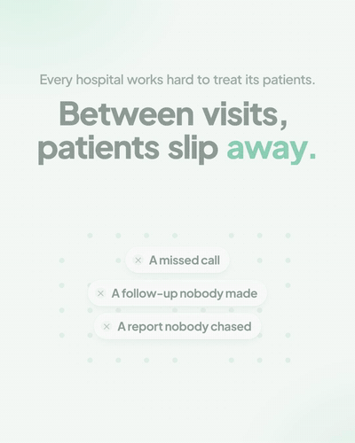
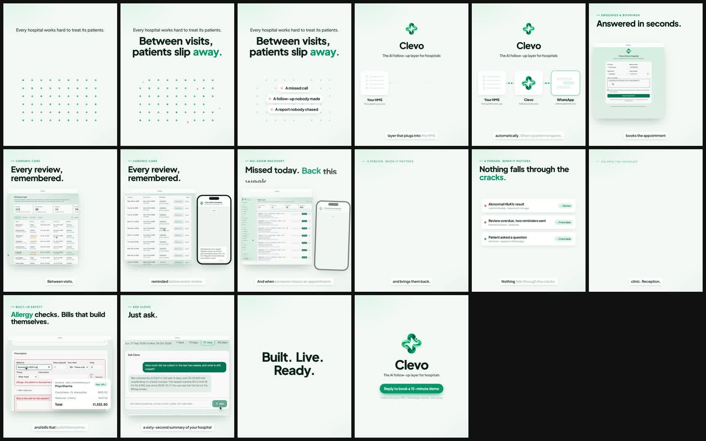

# product-video

**A Claude skill that turns a real web app into a professional, motion-graphics product video.** It covers
the story, a claims check against the real product, scripted screen recording with a camera that follows
the cursor, voiceover with word-level sync, Remotion composition, a broadcast-level sound mix, and a
frame-by-frame review. You describe the video; Claude makes it.

<p align="center">
  
</p>

<p align="center"><b><a href="docs/clevo-pitch.mp4">▶ Watch the full 75-second example</a></b> · made with this skill for <b>Clevo</b>, a hospital automation product</p>



## What you get

Ask for something like *"make a 60-second pitch video of my app for investors"*, and Claude:

1. **Writes the story:** problem, promise, 3–5 proof moments, trust, one clear ask. It then **checks every
   claim against the product** and stops if the script promises something that isn't built.
2. **Gets the product camera-ready:** healthy demo data, no internal codes on screen, personal data blurred,
   happy-path inputs.
3. **Records the real app** with a scripted browser at 2× resolution and a smooth drawn cursor. Every cursor
   move is logged so the video's camera can follow it.
4. **Voices it** with ElevenLabs (with automatic transcription checks for misread words), your own recording
   (auto-synced), or no voice at all (captions only).
5. **Composes it in Remotion:**
   - Kinetic type, the product in calm browser frames and a phone showing real messages.
   - Captions, and scenes that cut on the words that introduce them.
   - Output in **4:5, 9:16, 16:9 or 1:1** from one storyboard.
6. **Mixes the sound:** voice at -16 LUFS, licensed music ducked under it, subtle effects tied to what's on
   screen.
7. **Reviews it like a creative director:** contact sheets of still frames and a defect checklist, at least
   two passes, then automatic checks on the final file (size, length, loudness, true peak, silences).

## Install

**Claude Code (plugin):**

```bash
claude plugin marketplace add yashwanth-1729/product-video-skill
claude plugin install product-video@product-video-skill
```

**Claude Code (plain skill):** copy `skills/product-video` into `~/.claude/skills/` (or your project's
`.claude/skills/`).

**Claude.ai:** download `product-video.skill` from the
[Releases](https://github.com/yashwanth-1729/product-video-skill/releases) page and upload it under
Settings → Capabilities → Skills. Video work needs a local environment with Node and a browser, so Claude
Code is the best fit.

## Use

Just ask, in your own words:

> Make a 45-second launch reel of my app at localhost:3000 for Instagram. No voiceover, captions only.

> I need a 60-second pitch video for investors from our staging site, 4:5 for DMs, with a professional
> male voice. My ElevenLabs key is in .env.

> Turn our dashboard into a 30-second product demo for LinkedIn, 16:9, with our logo and brand colour.

Claude asks only what it can't infer (audience, where it'll be watched, length, voice), proposes defaults
for the rest, and shows you frames before the final render.

## Requirements

- **Node.js 18 or newer** (tested on 22) and about 1 GB of disk for Chromium and Remotion. ffmpeg comes
  bundled with Remotion, so nothing else needs installing.
- **Optional: an ElevenLabs API key**, for AI voice, voice verification, own-voice alignment and sound
  effects. The free plan works for trying it out (see licences below).
- **Your app,** running somewhere a browser can reach: localhost, staging, or a static build.
- Tested on Windows 11. The tools are plain Node and cross-platform.

## Usage and plan limits

<!-- USAGE:START -->
Measured on real runs (details in [Tests](#tests)):

| | Tokens per finished 1-minute video | Share of a 5-hour session |
|---|---|---|
| Claude Pro | _measuring…_ | _measuring…_ |
| Claude Max 5x | same tokens | about 1/5 of the Pro share |
| Claude Max 20x | same tokens | about 1/20 of the Pro share |

Most of the tokens are context re-read on each step, so a fresh session is far cheaper than adding a video
to a long one. Review passes and re-recordings add to it, and so do larger models.
<!-- USAGE:END -->

## How it works

```
skills/product-video/
├── SKILL.md                    the workflow Claude follows
├── references/                 read on demand: story, recording, voice, motion, sound, review, troubleshooting
├── scripts/init.mjs            creates a video project from the template
└── assets/template/            a ready Remotion project
    ├── scenes.config.mjs       what to record (one moment per scene)
    ├── script.txt              the voiceover, with [delivery cues]
    ├── tools/                  record · voice · align · sfx · frames · qa
    └── src/                    brand, formats, timing (word-anchored), scenes, components
```

The core idea is that **the voiceover is the clock**. Every voice source is converted to word timings
(`public/audio/words.json`), and scenes are placed with `at("phrase")`. Swap the voice, the language or the
take, and the video re-times itself.

## Tests

<!-- TESTS:START -->
_Results from the with-skill vs without-skill runs will appear here._
<!-- TESTS:END -->

The test cases live in `skills/product-video/evals/` in the `claude plugin eval` format, with a small
fictional demo app (Ledgerbird). Run them yourself with `claude plugin eval . --scaffold`.

## Licences and credits

- **This skill:** MIT.
- **Remotion** is free for individuals and companies of up to 3 people; larger companies need a
  [company licence](https://www.remotion.pro).
- **ElevenLabs:** the free plan requires attribution and is meant for non-commercial use. Paid plans include
  a commercial licence.
- **Music:** use licensed tracks only. The skill explains Pixabay Music and YouTube Audio Library terms,
  including Content ID.
- **Example video:** made for Clevo (shown with permission). Voice: ElevenLabs. Music: "Ambient Corporate
  Business Background" by alex-morgan, from Pixabay (Pixabay Content License). All patient data is fictional.

## Author

Built by **Yashwanth Cherukuri** while making Clevo's pitch video with Claude Code. Issues and pull requests
are welcome, especially new scene blocks, formats and voice providers.
